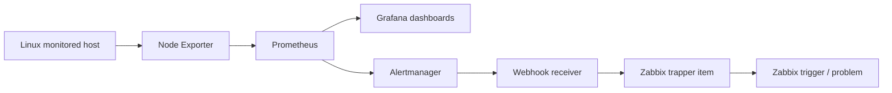

# Linux Infrastructure Monitoring & Alert Integration

A portfolio project demonstrating Linux host observability, dashboarding, alert rules, and cross-platform alert integration using Prometheus, Node Exporter, Grafana, Alertmanager, and Zabbix.

> **Project scope:** This repository documents a sanitized lab implementation. Example configuration files use placeholders and should be reviewed before use. Do not use this repository to disclose employer-confidential architecture, IP addresses, credentials, alert payloads, or screenshots without authorization.

## Highlights

- Monitor Linux host CPU, memory, filesystem, network, load, and service availability.
- Collect host metrics with Node Exporter and scrape them using Prometheus.
- Visualize metrics in Grafana and document example PromQL queries.
- Define example Prometheus alerting rules and Alertmanager routing.
- Document an optional webhook-to-Zabbix integration pattern.
- Include implementation notes, an operational runbook, troubleshooting guidance, security considerations, and a validation matrix.

## Architecture

The webhook-to-Zabbix path is an optional integration pattern. Validate its recovery behavior and Zabbix problem lifecycle in your own lab before representing it as production-ready.

## Repository layout

| Path | Purpose |
|---|---|
| `prometheus/` | Example scrape configuration and alert rules |
| `alertmanager/` | Example Alertmanager routing configuration |
| `grafana/` | Grafana-managed alert example and notes |
| `zabbix/` | Trapper integration guidance |
| `webhook/` | Webhook integration contract |
| `docs/ARCHITECTURE.md` | Components and data flows |
| `docs/IMPLEMENTATION.md` | Implementation approach and prerequisites |
| `docs/DASHBOARDS_AND_PROMQL.md` | Dashboard panels and query examples |
| `docs/ALERTING_AND_INTEGRATION.md` | Alert rules and integration flow |
| `docs/OPERATIONS_RUNBOOK.md` | Day-2 operational procedures |
| `docs/VALIDATION.md` | Validation and evidence checklist |
| `docs/SECURITY.md` | Sanitization and security practices |
| `docs/CV_BULLETS.md` | Resume-ready project description |
| `evidence/README.md` | Suggested evidence to collect |

## Getting started

1. Review [architecture](docs/ARCHITECTURE.md) and [implementation notes](docs/IMPLEMENTATION.md).
2. Copy the example configuration files into your lab working directories.
3. Replace placeholders with your own hostnames, scrape targets, and receiver endpoints.
4. Validate configuration syntax before restarting any services.
5. Follow the [operational runbook](docs/OPERATIONS_RUNBOOK.md).
6. Record the actual test results in the [validation checklist](docs/VALIDATION.md) and add sanitized evidence only after removing sensitive details.

### Important configuration note

Files named `*.example.yml` are templates, not drop-in production configuration. Prometheus and Alertmanager versions, rule syntax, service names, network access, and Zabbix item/trigger configuration can vary by environment. Back up existing configuration and validate with the installed binaries before applying changes.

## Validation status

The repository intentionally separates documentation from proof of execution. See [VALIDATION.md](docs/VALIDATION.md) for checks and evidence that should be captured. Do not mark a test as passed unless you have observed and recorded the result in your own environment.

## Security and disclosure

- No production credentials, tokens, internal hostnames, or private IPs should be committed.
- Use synthetic or sanitized screenshots and log excerpts.
- Confirm authorization before publishing any employer-owned implementation details.
- Keep real secrets in a secret manager or protected local configuration, not in Git.

## Technologies

Linux (RHEL/Rocky Linux lab), Prometheus, Node Exporter, Grafana, Alertmanager, Zabbix, PromQL, Python, systemd, YAML, Git.

## License

See [LICENSE](LICENSE).