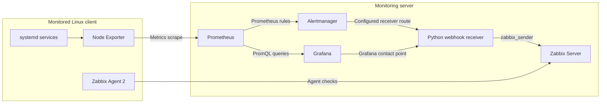

# Architecture

## Overview

The project has a monitoring plane and a notification/integration plane.

### Monitoring plane

1. Node Exporter exposes operating-system metrics from the Linux client.
2. Prometheus scrapes Node Exporter and stores metrics as time series.
3. Grafana queries Prometheus for dashboards and Explore investigations.
4. Prometheus-managed alert rules are evaluated by Prometheus and routed through Alertmanager.
5. Grafana-managed alert rules are evaluated by Grafana and routed through Grafana contact points and notification policies.

### Notification and integration plane

1. A matching alert condition transitions to firing.
2. The owning alert engine selects its configured notification path.
3. The configured webhook receiver accepts a notification.
4. The receiver parses the payload and invokes `zabbix_sender`.
5. Zabbix stores the submitted value in a trapper item and evaluates the associated trigger.

These paths are related but distinct. A Grafana contact-point test does not prove that a real rule's labels match a notification policy. A successful sender result does not prove that the correct Zabbix trigger opened or recovered.

## Logical diagram

## Network and trust boundaries

Use your own addresses and DNS names in private deployment documentation. For public documentation, use generic names such as `monitoring.example.net` and `linux-client.example.net`, or RFC 5737 documentation IP ranges.

- Prometheus must be able to reach the Node Exporter endpoint.
- Zabbix Server must be able to reach the agent when passive checks are used; active checks have different connection direction.
- Grafana's `127.0.0.1` webhook URL works only when the receiver shares the same host/network namespace.
- Restrict management ports to authorized networks.
- Do not expose unauthenticated webhook endpoints to untrusted networks.

## Components and responsibilities

| Component | Responsibility | Key checks |
|---|---|---|
| Node Exporter | Exposes host metrics | Service status, port, target health |
| Prometheus | Scrapes/stores metrics, evaluates rules | Config validation, targets, query results |
| Alertmanager | Routes Prometheus-managed alerts | Route matching, grouping, silences, receiver status |
| Grafana | Dashboards and Grafana-managed alerting | Data source, panels, rule evaluation, policies |
| Webhook receiver | Converts notifications into sender values | HTTP logs, payload parsing, sender output |
| Zabbix | Stores trapper item values and evaluates triggers | Latest data, trigger expression, Problems view |

## Design considerations

- Treat Prometheus-managed and Grafana-managed rules as separate alert engines.
- Design firing and recovery values explicitly at the webhook-to-Zabbix boundary.
- Use consistent labels for instance, environment, service, severity, and owner.
- Separate service health from scrape health: `up == 1` means a scrape succeeded, not that every application is healthy.
